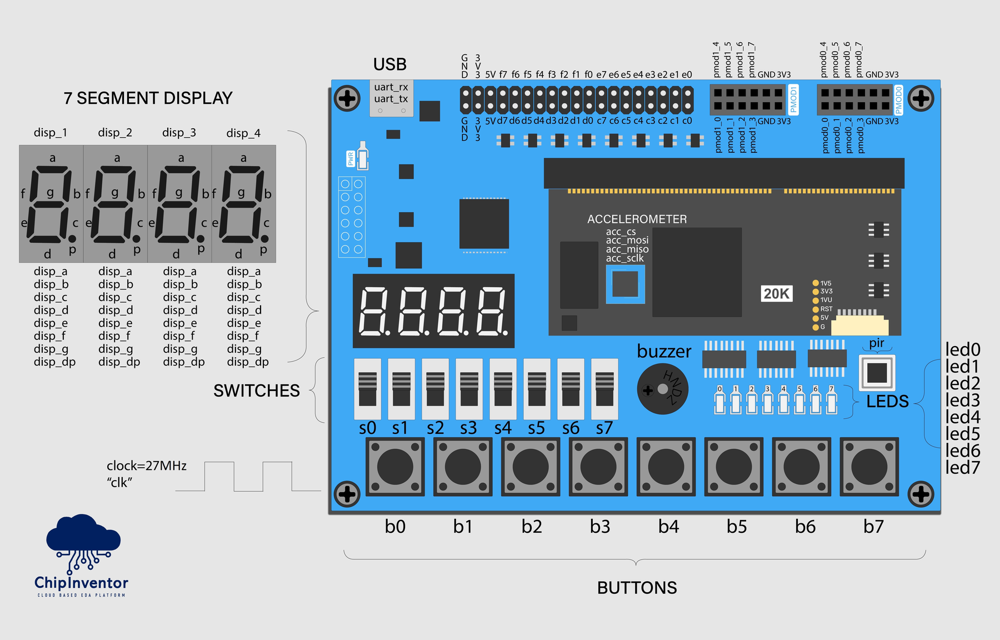
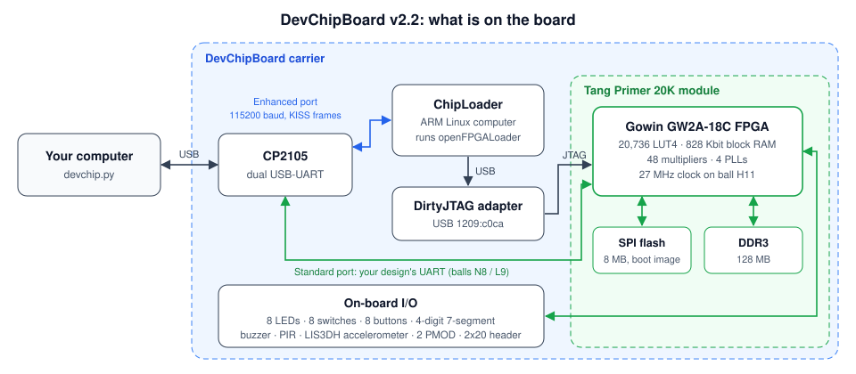
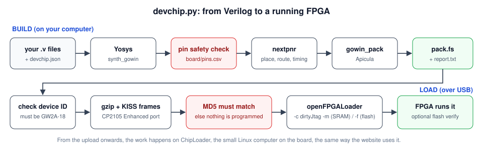

# DevChipBoard Local

**Build, simulate and program the ChipInventor DevChipBoard v2.2 from your own
computer, with open-source tools and no subscription.**

Everything runs over the board's normal USB connection. No JTAG adapter or
extra hardware is needed: the board's own on-board programmer ("ChipLoader")
does the programming, driven directly by this tool.

```text
python devchip.py run examples/blinky/blinky.v
```


<sub>Board diagram with the location names used everywhere in this project (image from the ChipInventor platform).</sub>

> Independent project, **not affiliated with ChipInventor or Sipeed**. No
> ChipInventor code is included. Use at your own risk; see [Safety](#5-safety).

| Document | Contents |
|---|---|
| **README.md** | Setup, usage, how it works |
| [docs/JOURNEY.md](docs/JOURNEY.md) | How the board was reverse-engineered, end to end |
| [docs/PINOUT.md](docs/PINOUT.md) | All 93 board pins: ball, direction, voltage, notes |
| [docs/PROTOCOL.md](docs/PROTOCOL.md) | The ChipLoader serial protocol |

---

## 1. Quick start

### You need
- **The board**, and **any USB data cable** for its USB port. A phone cable works if it carries data: some cheap cables only carry power, and with those the board never shows up.
- **CP210x driver.** On Windows/macOS, install the [Silicon Labs CP210x VCP driver](https://www.silabs.com/developer-tools/usb-to-uart-bridge-vcp-drivers). Linux has it built in.
- **[OSS CAD Suite](https://github.com/YosysHQ/oss-cad-suite-build/releases).** Download and extract it. It provides Yosys, nextpnr-himbaechel, Apicula (gowin_pack) and Icarus Verilog.
- **Python 3.8+** with pyserial: `pip install -r requirements.txt`.

Developed and verified on Windows 11. Linux and macOS use the same Python
code and standard drivers, but have not been tried yet.

### Setup
1. **Plug the board in.** It appears as two serial ports:
   - **Windows:** *CP2105 … Enhanced COM Port* and *… Standard COM Port*.
   - **Linux:** two `/dev/ttyUSB*` devices. Add yourself to the `dialout` group, then log in again.
2. **Tell the tool where OSS CAD Suite is.** The setting lasts for the current terminal; alternatively, pass `--oss <dir>` to each command.
   ```text
   Windows (cmd)        set OSS_CAD_SUITE=C:\path\to\oss-cad-suite
   Windows (PowerShell) $env:OSS_CAD_SUITE="C:\path\to\oss-cad-suite"
   Linux / macOS        export OSS_CAD_SUITE=$HOME/oss-cad-suite
   ```
3. **Close the ChipInventor web page** if it is open. Only one program can use the board's port at a time.
4. **Check everything:**
   ```text
   python devchip.py doctor
   ```
   It should end with `all good`.
5. **Back up the design stored in the board's flash.** This is optional but recommended: on a new board the flash holds the factory demo, and the backup takes about 2 minutes.
   ```text
   python devchip.py flash backup factory_flash.bin
   ```
6. **Run something:**
   ```text
   python devchip.py run examples/blinky/blinky.v
   ```

## 2. Commands

| Command | What it does |
|---|---|
| `new NAME` | Create a project folder (`src/top.v` + `devchip.json`) |
| `build [files…]` | Synthesize, check pins, place and route, and write `build/pack.fs` plus `build/report.txt` |
| `run [files…]` | `build`, then load into the FPGA |
| `load FILE.fs` | Load an existing bitstream (also accepts Gowin IDE `.fs` files) |
| `sim [files…] --tb TB.v` | Simulate with Icarus Verilog |
| `reset` | Restart the FPGA from its flash, as at power-up |
| `flash id` | Read the flash chip's ID |
| `flash backup FILE` | Save the whole boot flash (read-only, CRC-checked, read twice) |
| `flash verify FILE` | Compare the flash with a backup |
| `flash restore FILE` | Write a backup back, then verify it |
| `pll MHZ` | Generate a configured PLL module for a clock frequency |
| `pins` | List all board pin names |
| `doctor` | Check Python, tools, driver, board and JTAG |
| `info` | ChipLoader diagnostics |
| `gen` | Regenerate `board/devchipboard_v2.2.cst` and `docs/PINOUT.md` from `board/pins.csv` |

**Build options:**
- `--top NAME`
- `-D NAME=VAL`
- `-I DIR`
- `--cst FILE`: extra I/O attributes
- `--freq MHZ`: timing target, default 27
- `--seed N`
- `--out DIR`
- `--project DIR`: use a `devchip.json`

**Load options:**
- `--persistent`: write the boot flash instead of SRAM
- `--verify`: read the flash back after a persistent write
- `--yes`: skip the confirmation prompt
- `--port` and `--uart-port`: choose the serial ports by hand instead of auto-detecting them

### SRAM or flash?
- **SRAM (default):** fast and unlimited. The design is gone when the board loses power, and the flash design boots again.
- **`--persistent`:** writes the boot flash, so the design survives power-off. It replaces what was there and asks first. Add `--verify` to read the flash back and compare it byte for byte. Keep a `flash backup` so you can always `flash restore` the original.

```text
python devchip.py run mydesign.v --persistent --verify
python devchip.py flash restore factory_flash.bin
```

## 3. Writing designs

- **Top module:** `top`. Use `--top` for another name.
- **Ports are named after the board locations** shown in the image above. `python devchip.py pins` lists them:
  `clk`, `led0`–`led7`, `s0`–`s7`, `b0`–`b7`, `disp_a`–`disp_g`, `disp_dp`, `disp_1`–`disp_4`,
  `buzzer`, `pir`, `uart_tx`, `uart_rx`, `acc_cs`/`acc_sclk`/`acc_mosi`/`acc_miso`,
  `pmod0_0`–`pmod1_7`, `c0`–`f7`.
- **Buses map automatically.** For example, `output [7:0] led` becomes `led0`–`led7`, and `inout [7:0] pmod0` becomes `pmod0_0`–`pmod0_7`. The same applies to `s`, `b`, `c`, `d`, `e`, `f` and `pmod1`.
- **No pin constraints to write.** The tool generates them from [board/pins.csv](board/pins.csv).
  - For I/O attributes (pull-ups, drive strength, …), pass a file with `--cst` containing only `IO_PORT` lines, e.g. `IO_PORT "c[0]" PULL_MODE=UP;`.
  - Pin locations can't be overridden, which is what keeps the safety checks meaningful.
- **Clock:** `clk` is **27 MHz**. For another frequency, run `python devchip.py pll 100` and instantiate the generated module ([example](examples/pll/pll_demo.v)). Build with `--freq` set to that frequency, so timing is checked at the real clock.
- **All on-board I/O is active-high:**
  - LEDs light on 1
  - switches read 1 when on
  - buttons read 1 while pressed
  - 7-segment segments and digit enables are on at 1
- **The 7-segment display is multiplexed:** the four digits share `disp_a`–`disp_dp`. Enable one digit at a time with `disp_1`–`disp_4`, at about 1 kHz each.
- **UART:** `uart_tx` and `uart_rx` reach your computer through the CP2105 **Standard** port, so any serial terminal works. The **Enhanced** port belongs to ChipLoader.
- **Build report:** every build writes `build/report.txt`, covering:
  - resource use: LUTs, flip-flops, block RAM, multipliers, PLLs, I/O
  - the maximum frequency of each clock, with pass/fail against the target
  - warning counts and **inferred latches**
  - every pin used

### Projects
```text
python devchip.py new blinker
python devchip.py run --project blinker
```
`devchip.json` holds:
- `top`
- `sources`
- `defines`
- `includes`
- `constraints` (the `--cst` file)
- `freq_mhz`
- `testbench` (used by `sim`)

### Examples
| Example | Shows |
|---|---|
| [blinky](examples/blinky/blinky.v) | Clock and LED bus |
| [selftest](examples/selftest/selftest.v) | All on-board peripherals: switches, LEDs, buttons, 7-segment, buzzer, PIR, UART. Testbench: [sim/tb_selftest.v](sim/tb_selftest.v) |
| [pir_monitor](examples/pir_monitor/pir_monitor.v) | Logging the PIR motion sensor over UART |
| [accelerometer](examples/accelerometer/) | UART-to-SPI bridge plus `accel.py`, which identifies the LIS3DH and prints X/Y/Z |
| [pll](examples/pll/pll_demo.v) | Running logic at 135 MHz from a generated PLL |
| [pin_tester](examples/pin_tester/) | Reading all 48 PMOD/header pins; touch a pin with GND to identify it |

```text
python devchip.py run examples/selftest/selftest.v rtl/uart_tx.v
python devchip.py run examples/accelerometer/accel_bridge.v rtl/uart_rx.v rtl/uart_tx.v rtl/spi_master.v
python examples/accelerometer/accel.py
```

Reusable building blocks are in [rtl/](rtl/): `uart_tx.v`, `uart_rx.v` and `spi_master.v`.

## 4. How it works

### The board


- **The FPGA module is a Sipeed Tang Primer 20K.** It carries:
  - a Gowin **GW2A-LV18PG256C8/I7**: 20,736 LUT4s, 15,552 flip-flops, 828 Kbit of block RAM, 48 multipliers and PLLs
  - 128 MB of DDR3
  - an **8 MB SPI flash** (XTX, JEDEC ID `0B 40 17`) holding the boot design
  - a 27 MHz oscillator
- **The CP2105** is the board's only USB device. It provides two serial ports and no JTAG.
- **ChipLoader** is a small ARM Linux computer on the carrier board:
  - It receives bitstreams on the **Enhanced** port, using KISS-framed messages at 115200 baud.
  - It runs **openFPGALoader**, which programs the FPGA through a **DirtyJTAG** USB-to-JTAG adapter that is also on the board.
- **The Standard port** goes straight to the FPGA's `uart_rx`/`uart_tx` pins (balls N8 and L9).

### The tool


1. **Build.** This is the same open-source flow ChipInventor's cloud uses: Yosys, then nextpnr-himbaechel, then gowin_pack.
   - Between synthesis and place-and-route, every top-level port is checked against the board's pin database.
   - Configuration pins that a design uses (READY, RECONFIG_N, slave-SPI) are released as normal I/O **only when used**.
2. **Load.**
   1. The bitstream must belong to the GW2A-18 (IDCODE `0x0000081B`).
   2. It is gzipped and uploaded the way the website does it.
   3. ChipLoader's MD5 must match the local one, or nothing is programmed.
   4. `openFPGALoader -c dirtyJtag` then loads SRAM (`-m`) or flash (`-f`).
3. **Flash backup.** openFPGALoader can't read this chip's flash back, so `flash backup` does it differently:
   1. It loads a small **read-only** design ([devchiplib/hdl/flash_reader.v](devchiplib/hdl/flash_reader.v)) into SRAM. That design reads the flash chip directly and can't issue the flash's write-enable command.
   2. It streams the contents to the PC over the Standard port at 921600 baud, in CRC-protected 64 KiB blocks.
   3. The used region is read a second time and must match.

## 5. Safety

The tool refuses anything that could damage the board or lock you out:
- **Driving a pin the board drives** (switches, buttons, PIR, accelerometer MISO, UART RX, clock) is refused at build time. Two outputs fighting each other can damage a pin.
- **Unknown pin names**, **a pin used twice**, and **pin locations in `--cst` files** are refused.
- **Bitstreams for any other FPGA** are refused, and **corrupted uploads** are never programmed (MD5 check).
- **The JTAG pins are never released** for user logic, because JTAG is how the board is programmed. The boot-flash pins are only used by the read-only flash reader.
- **Only fixed commands are sent to ChipLoader.** Nothing you type is passed to its shell.
- **Writing the flash asks for confirmation.** An interrupted write can always be redone, because JTAG stays available.

What the tool can't see is what you connect to the PMOD and header pins:
- The **2×20 header has 5 V and 3.3 V supply pins**. Never wire them to a signal pin.
- Header pins **`c6`, `e6`, `e7`** are on a **1.5 V** bank (the build warns you). Never connect 3.3 V or 5 V signals to them.
- All other user pins are **3.3 V**.
- Header pins **`d5`, `d7`, `f6`, `f7`** are weakly pulled high on the carrier, so they read 1 when nothing drives them. They work normally as inputs or outputs.

## 6. Troubleshooting

| Symptom | Fix |
|---|---|
| `No DevChipBoard found` | Use a USB **data** cable, install the CP210x driver, and try another USB port |
| `Cannot open COMx` | Close the ChipInventor web page and any serial monitor |
| `No answer from ChipLoader` | The tool already retries and re-synchronises ChipLoader by itself (for example after an interrupted upload). If the error persists, close other programs using the port, then unplug the board for 5 seconds. |
| `Missing tools` | Set `OSS_CAD_SUITE`, or pass `--oss` |
| `Pin check failed` | The message names the port. See [docs/PINOUT.md](docs/PINOUT.md) for the valid names and directions. |
| Timing `FAIL` in the build output | Simplify the logic between registers, pipeline it, or lower the clock (`pll`) |
| Nothing on the serial terminal | `uart_tx` is on the **Standard** port. Check the baud rate your design uses. |

For a deeper look, set `DEVCHIP_DEBUG_LOG=trace.log` to record the raw ChipLoader traffic.

## 7. Repository layout
```text
devchip.py                 command-line tool
devchiplib/                board database, build flow, ChipLoader client, flash tools, PLL solver
devchiplib/hdl/            internal designs (read-only flash reader)
board/pins.csv             the board pin database: the single source of truth
board/devchipboard_v2.2.cst  complete constraint file (generated), for use with other tools
rtl/                       reusable Verilog: uart_tx, uart_rx, spi_master
examples/                  blinky, selftest, pir_monitor, accelerometer, pll, pin_tester
sim/tb_selftest.v          example testbench (python devchip.py sim)
tools/cloudcst_to_pins.py  rebuild pins.csv from a ChipInventor .cst file
tools/pinmap/map_all.v     helper used to extract the pin map from the website
docs/                      journey, pinout, protocol, diagrams
```

## Credits
- [YosysHQ](https://github.com/YosysHQ) (Yosys, nextpnr, OSS CAD Suite)
- [Project Apicula](https://github.com/YosysHQ/apicula)
- [openFPGALoader](https://github.com/trabucayre/openFPGALoader)
- [DirtyJTAG](https://github.com/jeanthom/DirtyJTAG)
- Sipeed (Tang Primer 20K)

DevChipBoard, ChipInventor and the board image belong to their respective owners.

## License
MIT. See [LICENSE](LICENSE).
